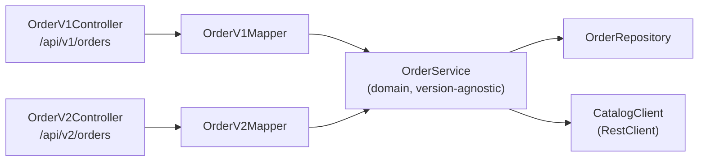

# API Migration Guide: Orders `v1` → `v2`

| Field | Value |
| :--- | :--- |
| Version | 1.1 (resolved, aligned to PRD v1.1) |
| Required by | PRD §11.5 ("A migration guide with a field mapping table") |
| Scope | The Order resource only (Decision D4). Catalog and auth endpoints are unchanged and exist only under `/api/v1` |
| Contract | [`openapi.yaml`](./openapi.yaml): schemas `V1Order*` and `V2Order*` |

---

## 1. Summary

`/api/v2/orders` replaces v1's flat order fields with nested objects and adds a `paymentSummary`. Both versions run at the same time on the same `order-service`. They share one domain layer and one database and differ only in their DTOs. An order created through v1 can be read, edited, and paid through v2, and the reverse also works.

| | v1 (legacy) | v2 (current) |
| :--- | :--- | :--- |
| Customer | `customerName` at root | `customer.name` |
| Location | `outletId`, `tableCode` at root | `location.outletId`, `location.tableCode` |
| Total | `totalAmount` at root | `paymentSummary.totalAmount` |
| Payment info | Never exposed | `paymentSummary.{paymentStatus, paymentMethod, amountTendered, change}` |
| Who uses it | Customer page when the demo toggle is set to `v1` | Customer page (default), **all staff dashboards** |

## 2. Why v2 Exists

1. **Grouping.** Customer identity and table location are separate concepts. Nesting them makes the payload self-describing and leaves room to extend each group later without adding more root fields.
2. **Payment visibility.** The Cashier needs to see the payment method, cash tendered, and change after paying. v1 has nowhere to put these without bloating the root, so v2 introduces `paymentSummary` and moves `totalAmount` into it.
3. **Course requirement.** The project has to show an intentional, documented breaking change served alongside the old version (PRD goal G6).

## 3. Why It Is Breaking

A change is breaking if an unmodified v1 client fails against v2. Two things fail:

| Direction | What fails | Result |
| :--- | :--- | :--- |
| Response | A v1 client reads `order.customerName`, `order.tableCode`, `order.outletId`, `order.totalAmount` at the root | `undefined` / null. The UI shows blanks or `NaN` totals |
| Request | A v1 client sends a flat body to `POST` or `PUT /api/v2/orders` | `400 VALIDATION_ERROR`, because the required `customer` and `location` objects are missing |

## 4. Field Mapping

### 4.1 Request (`POST /orders`, `PUT /orders/{id}`)

| v1 field | v2 field | Notes |
| :--- | :--- | :--- |
| `outletId` | `location.outletId` | |
| `tableCode` | `location.tableCode` | |
| `customerName` | `customer.name` | Trimmed, 1–50 chars in both |
| `items[]` | `items[]` | **Unchanged**: `{ menuItemId, quantity }` |

### 4.2 Response (every endpoint that returns an order)

| v1 field | v2 field | Notes |
| :--- | :--- | :--- |
| `id` | `id` | Unchanged |
| `orderNumber` | `orderNumber` | Unchanged |
| `status` | `status` | Unchanged |
| `outletId` | `location.outletId` | Moved |
| `tableCode` | `location.tableCode` | Moved |
| `customerName` | `customer.name` | Moved |
| `totalAmount` | `paymentSummary.totalAmount` | Moved |
| - | `paymentSummary.paymentStatus` | **New.** `UNPAID` or `PAID` |
| - | `paymentSummary.paymentMethod` | **New.** `CASH` / `QRIS` / `CARD`, null until paid |
| - | `paymentSummary.amountTendered` | **New.** CASH only, otherwise null |
| - | `paymentSummary.change` | **New.** CASH only, otherwise null |
| `items[]` | `items[]` | **Unchanged**: `{ menuItemId, name, unitPrice, quantity, subtotal }` |
| `createdAt`, `updatedAt` | `createdAt`, `updatedAt` | Unchanged |

## 5. Side-by-Side Payloads

### 5.1 Create request

```json
// v1  POST /api/v1/orders
{ "outletId": "OUT-01", "tableCode": "T-01", "customerName": "Budi",
  "items": [ { "menuItemId": "11111111-0000-4000-8000-000000000001", "quantity": 2 } ] }
```

```json
// v2  POST /api/v2/orders
{ "customer": { "name": "Budi" },
  "location": { "outletId": "OUT-01", "tableCode": "T-01" },
  "items": [ { "menuItemId": "11111111-0000-4000-8000-000000000001", "quantity": 2 } ] }
```

### 5.2 Response after a CASH payment

```json
// v1  POST /api/v1/orders/{id}/pay → no payment details, by design
{ "id": "7d3c0d4e-2f7a-4f63-9a51-0b8c2f3e9a10", "orderNumber": "ORD-0042",
  "outletId": "OUT-01", "tableCode": "T-01", "customerName": "Budi",
  "status": "PREPARING",
  "items": [ { "menuItemId": "11111111-0000-4000-8000-000000000001", "name": "Mie Suit",
               "unitPrice": 25000, "quantity": 2, "subtotal": 50000 } ],
  "totalAmount": 50000,
  "createdAt": "2026-10-21T10:00:00Z", "updatedAt": "2026-10-21T10:03:12Z" }
```

```json
// v2  POST /api/v2/orders/{id}/pay
{ "id": "7d3c0d4e-2f7a-4f63-9a51-0b8c2f3e9a10", "orderNumber": "ORD-0042",
  "status": "PREPARING",
  "customer": { "name": "Budi" },
  "location": { "outletId": "OUT-01", "tableCode": "T-01" },
  "items": [ { "menuItemId": "11111111-0000-4000-8000-000000000001", "name": "Mie Suit",
               "unitPrice": 25000, "quantity": 2, "subtotal": 50000 } ],
  "paymentSummary": { "totalAmount": 50000, "paymentStatus": "PAID",
                      "paymentMethod": "CASH", "amountTendered": 60000, "change": 10000 },
  "createdAt": "2026-10-21T10:00:00Z", "updatedAt": "2026-10-21T10:03:12Z" }
```

### 5.3 v2 `paymentSummary` by state

| Order state | `paymentStatus` | `paymentMethod` | `amountTendered` | `change` |
| :--- | :--- | :--- | :--- | :--- |
| `PENDING`, `ACCEPTED`, `CANCELLED` | `UNPAID` | `null` | `null` | `null` |
| Paid with `CASH` | `PAID` | `CASH` | number | number |
| Paid with `QRIS` / `CARD` | `PAID` | `QRIS` / `CARD` | `null` | `null` |

`PREPARING`, `READY`, and `COMPLETED` orders are always `PAID`, because the only way into `PREPARING` is through `pay`.

## 6. What Does Not Change

- **Paths:** identical apart from the version segment.
- **Bodies of `PATCH /orders/{id}/status` and `POST /orders/{id}/pay`:** identical. Only their *responses* follow the called version's order shape (PRD §11.5).
- **Item shape** in requests and responses.
- **Status codes, error format, and error codes.**
- **Auth, roles, outlet scope, and state machine.**
- **Data:** both versions read and write the same rows.

## 7. Server Implementation Rules

These come from PRD §2 rule 5 and §13 (Maintainability):

1. **One domain service.** `OrderService` takes and returns domain objects. It knows nothing about versions.
2. **Separate DTOs per version** in packages `...dto.v1` and `...dto.v2`. Never merge them into one class with optional fields.
3. **Separate mappers:** `OrderV1Mapper` and `OrderV2Mapper` convert DTO ↔ domain.
4. **Separate controllers:** `OrderV1Controller` (`/api/v1/orders`) and `OrderV2Controller` (`/api/v2/orders`). They stay thin and only delegate.
5. The `PATCH status` and `pay` request DTOs are identical. Keep one shared class each in `dto.common` (for example `OrderStatusPatchRequest` and `PaymentRequest`), because only their responses are versioned (PRD D19). Rule 5 applies to versioned Order DTOs; these common command DTOs are intentionally shared.



## 8. Client Migration Steps (frontend)

1. Change the base path from `/api/v1/orders` to `/api/v2/orders`.
2. Replace the TypeScript types and Zod schemas:

```ts
// v1
type OrderV1 = {
  id: string; orderNumber: string; status: OrderStatus;
  outletId: string; tableCode: string; customerName: string;
  items: OrderItem[]; totalAmount: number; createdAt: string; updatedAt: string;
};

// v2
type OrderV2 = {
  id: string; orderNumber: string; status: OrderStatus;
  customer: { name: string };
  location: { outletId: string; tableCode: string };
  items: OrderItem[];
  paymentSummary: {
    totalAmount: number;
    paymentStatus: 'UNPAID' | 'PAID';
    paymentMethod: 'CASH' | 'QRIS' | 'CARD' | null;
    amountTendered: number | null;
    change: number | null;
  };
  createdAt: string; updatedAt: string;
};
```

3. Update every reader: `order.customerName` → `order.customer.name`, `order.tableCode` → `order.location.tableCode`, `order.totalAmount` → `order.paymentSummary.totalAmount`.
4. Update request builders for `POST` and `PUT` to send the nested body.
5. After paying, show `paymentSummary.change` on the Cashier payment confirmation.
6. Keep the v1 client code only for the customer-page demo toggle (PRD §12). The confirmation screen shows which version was used.

## 9. Verification Checklist (covers AC-10)

- [ ] `POST /api/v1/orders` with a v1 body → `201`, flat response.
- [ ] `POST /api/v2/orders` with a v2 body → `201`, nested response, `paymentStatus: UNPAID`.
- [ ] `POST /api/v2/orders` with a **v1** body → `400 VALIDATION_ERROR`.
- [ ] `POST /api/v1/orders` with a **v2** body → `400 VALIDATION_ERROR`.
- [ ] Order created via v1 → `GET /api/v2/orders/{id}` returns it in v2 shape (and the reverse).
- [ ] `POST /api/v2/orders/{id}/pay` with CASH → `paymentSummary.change` is correct.
- [ ] `POST /api/v1/orders/{id}/pay` → flat response with no payment fields.
- [ ] `PATCH /status` returns the called version's shape in both versions.

> [!NOTE]
> AC-05 ("returns `PREPARING` and the correct change") can only be checked through **v2**, because v1 never exposes `change`.

## 10. Deprecation Policy

v1 stays live and supported until the end of course evaluation. There is no sunset date, and no `Deprecation`/`Sunset` headers are sent (PRD D19).

## 11. Resolved Decisions

The former OQ-MIG-01 through OQ-MIG-03 are closed by PRD §19, decision D19.

| Area | Final rule |
| :--- | :--- |
| v1 support | Remains supported through course evaluation; no deprecation or sunset headers |
| Unknown JSON fields | Keep the configured Jackson default (ignore unknown fields); required v2 nested fields remain validated. Confirm with a Boot 4 integration test |
| Shared requests | Share status-patch and payment request DTOs in `dto.common`; keep v1/v2 response DTOs separate |
