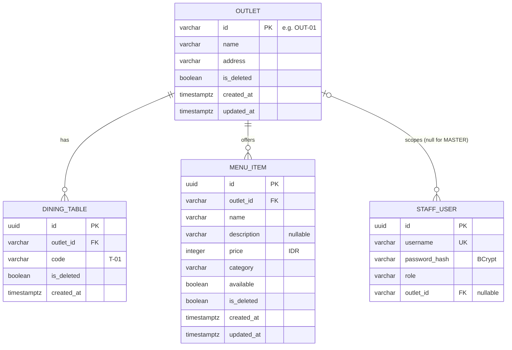
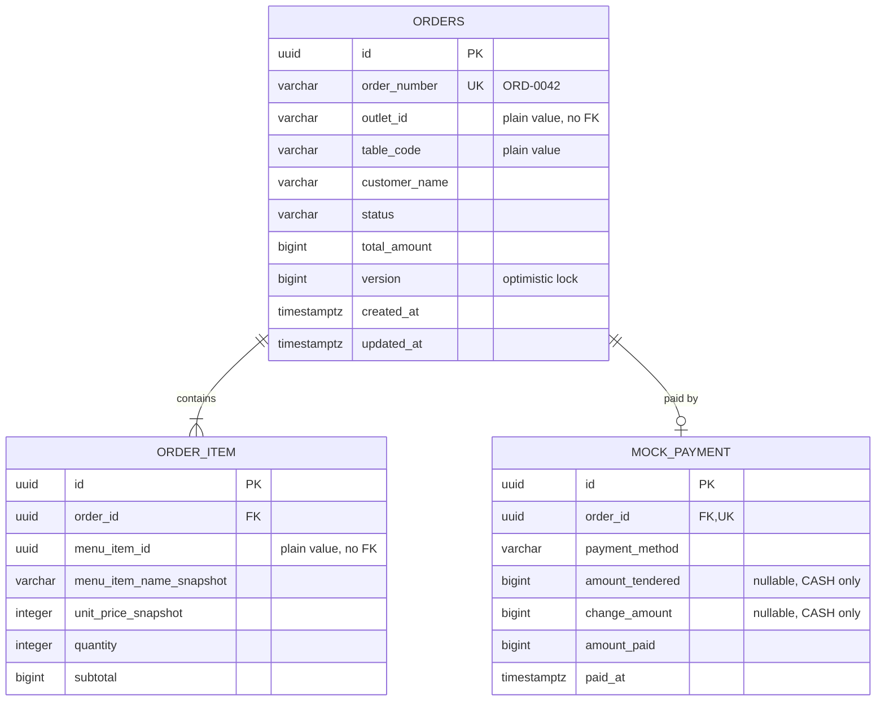

# Database Design and Data Dictionary — Dikichi Order Management Platform

| Field | Value |
| :--- | :--- |
| Version | 1.1 (resolved, aligned to PRD v1.1) |
| DBMS | PostgreSQL 16, schema managed by Flyway |
| Source of truth | PRD §8.3, §9, §10, §13. If this document conflicts with the PRD, the PRD wins |
| Related | [`Software-Architecture-Document.md`](./Software-Architecture-Document.md), [`openapi.yaml`](./openapi.yaml) |

> **Decision rule.** Database design decisions are resolved in PRD §19, decisions D20–D24. Seeded names, prices, and addresses are explicitly demo data, not claims about a production outlet.

---

## 1. Principles

1. **Database per service.** `catalog-service` owns `catalog_db` and `order-service` owns `order_db`. No service reads another service's database (PRD §8.3).
2. **No cross-database foreign keys.** `order_db` stores `outlet_id`, `table_code`, and `menu_item_id` as plain values. Their validity is checked over HTTP via `/internal/orders/validate`.
3. **Snapshots for history.** An order line stores the item name and unit price as they were at create/`PUT` time. Later catalog edits or deletes never change past orders.
4. **Soft delete in the catalog.** `is_deleted = true` hides a row from every read and list and rejects it for new orders. The row stays in the database so history remains auditable.
5. **Integer money.** Prices are integer IDR (`INTEGER`, at most 10,000,000). Totals and payment amounts use `BIGINT`.
6. **Flyway owns the schema.** Hibernate runs with `ddl-auto=validate`, so it never creates or alters tables (PRD D23).

## 2. `catalog_db` (owned by `catalog-service`)

### 2.1 ERD



### 2.2 Data dictionary

**`outlet`**

| Column | Type | Null | Default | Constraint / Note |
| :--- | :--- | :---: | :--- | :--- |
| `id` | `VARCHAR(20)` | N | — | PK. Human-readable key (D7). Check `^OUT-[0-9]{2,}$` (PRD D17) |
| `name` | `VARCHAR(100)` | N | — | Length fixed by PRD D17 |
| `address` | `VARCHAR(255)` | N | — | Length 1–255 and NOT NULL (PRD D17) |
| `is_deleted` | `BOOLEAN` | N | `false` | Soft delete |
| `created_at` | `TIMESTAMPTZ` | N | `now()` | |
| `updated_at` | `TIMESTAMPTZ` | N | `now()` | Set by the application on update |

**`dining_table`** (named `dining_table` because `table` is a reserved word)

| Column | Type | Null | Default | Constraint / Note |
| :--- | :--- | :---: | :--- | :--- |
| `id` | `UUID` | N | `gen_random_uuid()` | PK |
| `outlet_id` | `VARCHAR(20)` | N | — | FK → `outlet(id)` |
| `code` | `VARCHAR(5)` | N | — | Check `^T-[0-9]{2,3}$` |
| `is_deleted` | `BOOLEAN` | N | `false` | |
| `created_at` | `TIMESTAMPTZ` | N | `now()` | |
| — | — | — | — | Partial unique index on `(outlet_id, code) WHERE is_deleted = false`. A code can be reused after deletion |

**`menu_item`**

| Column | Type | Null | Default | Constraint / Note |
| :--- | :--- | :---: | :--- | :--- |
| `id` | `UUID` | N | `gen_random_uuid()` | PK |
| `outlet_id` | `VARCHAR(20)` | N | — | FK → `outlet(id)`. Indexed (PRD §13) |
| `name` | `VARCHAR(100)` | N | — | 1–100 chars |
| `description` | `VARCHAR(500)` | Y | — | Nullable (PRD D24) |
| `price` | `INTEGER` | N | — | Check `1..10,000,000` |
| `category` | `VARCHAR(50)` | N | — | Free text, 1–50 chars |
| `available` | `BOOLEAN` | N | `true` | Toggled by `PATCH /availability` |
| `is_deleted` | `BOOLEAN` | N | `false` | |
| `created_at` / `updated_at` | `TIMESTAMPTZ` | N | `now()` | |

**`staff_user`**

| Column | Type | Null | Default | Constraint / Note |
| :--- | :--- | :---: | :--- | :--- |
| `id` | `UUID` | N | `gen_random_uuid()` | PK |
| `username` | `VARCHAR(50)` | N | — | Unique |
| `password_hash` | `VARCHAR(100)` | N | — | BCrypt (60 chars). Never logged or returned |
| `role` | `VARCHAR(10)` | N | — | Check `IN ('MASTER','CASHIER','KITCHEN')` |
| `outlet_id` | `VARCHAR(20)` | Y | — | FK → `outlet(id)`. Check: `outlet_id IS NULL` if and only if `role = 'MASTER'` (PRD D24) |

## 3. `order_db` (owned by `order-service`)

### 3.1 ERD



### 3.2 Data dictionary

**`orders`** (plural because `order` is a reserved word)

| Column | Type | Null | Default | Constraint / Note |
| :--- | :--- | :---: | :--- | :--- |
| `id` | `UUID` | N | `gen_random_uuid()` | PK |
| `order_number` | `VARCHAR(20)` | N | — | Unique. `ORD-` + sequence, at least 4 digits (§3.4) |
| `outlet_id` | `VARCHAR(20)` | N | — | Validated via catalog. No FK |
| `table_code` | `VARCHAR(5)` | N | — | Validated via catalog. No FK |
| `customer_name` | `VARCHAR(50)` | N | — | Trimmed, 1–50 chars |
| `status` | `VARCHAR(10)` | N | — | Check `IN ('PENDING','ACCEPTED','PREPARING','READY','COMPLETED','CANCELLED')` |
| `total_amount` | `BIGINT` | N | — | `sum(order_item.subtotal)`. Check `> 0` |
| `version` | `BIGINT` | N | `0` | JPA `@Version`. A lost race returns `409 CONCURRENT_MODIFICATION` |
| `created_at` / `updated_at` | `TIMESTAMPTZ` | N | `now()` | Queue ordering uses `created_at ASC` |
| — | — | — | — | Index `(outlet_id, status)` (PRD §13) |

**`order_item`**

| Column | Type | Null | Default | Constraint / Note |
| :--- | :--- | :---: | :--- | :--- |
| `id` | `UUID` | N | `gen_random_uuid()` | PK |
| `order_id` | `UUID` | N | — | FK → `orders(id)` |
| `menu_item_id` | `UUID` | N | — | Plain value from the catalog |
| `menu_item_name_snapshot` | `VARCHAR(100)` | N | — | Copied from the catalog at create/`PUT` |
| `unit_price_snapshot` | `INTEGER` | N | — | Copied from the catalog. Check `1..10,000,000` |
| `quantity` | `INTEGER` | N | — | Check `1..99` |
| `subtotal` | `BIGINT` | N | — | `unit_price_snapshot * quantity`. Check enforces it (PRD D24) |
| — | — | — | — | Unique `(order_id, menu_item_id)` (PRD D24). Duplicate lines are rejected at the API (`400`), and this is a second guard |

**`mock_payment`**

| Column | Type | Null | Default | Constraint / Note |
| :--- | :--- | :---: | :--- | :--- |
| `id` | `UUID` | N | `gen_random_uuid()` | PK |
| `order_id` | `UUID` | N | — | FK → `orders(id)`. **Unique**, so an order cannot be paid twice (PRD §13) |
| `payment_method` | `VARCHAR(5)` | N | — | Check `IN ('CASH','QRIS','CARD')` |
| `amount_tendered` | `BIGINT` | Y | — | CASH only, ≥ `amount_paid` |
| `change_amount` | `BIGINT` | Y | — | CASH only, `= amount_tendered − amount_paid`. Exposed as `change` in v2 |
| `amount_paid` | `BIGINT` | N | — | Equals `orders.total_amount` |
| `paid_at` | `TIMESTAMPTZ` | N | `now()` | |
| — | — | — | — | Check: CASH requires both nullable columns; QRIS/CARD require both to be null (PRD D24) |

### 3.3 Integrity guarantees

| Guarantee | Mechanism |
| :--- | :--- |
| No double payment | Unique `mock_payment.order_id`, plus a status check inside the transaction |
| Atomic pay | Inserting `mock_payment` and setting `status = PREPARING` happen in one `@Transactional` method |
| No lost status race | `orders.version` (`@Version`). The losing transaction gets `409 CONCURRENT_MODIFICATION` |
| Valid transitions | Checked against the persisted status inside the transaction, never against client input |
| Stable history | Name and price snapshots on `order_item`. Catalog rows are soft-deleted only |
| `PUT` replaces items | Old `order_item` rows are deleted and new ones inserted (JPA `orphanRemoval = true`). `total_amount` is recomputed |

### 3.4 Order number generation

```sql
CREATE SEQUENCE order_number_seq START WITH 1 INCREMENT BY 1;
```

Format the number in Java as `String.format("ORD-%04d", nextval)`.

> [!WARNING]
> Do **not** use PostgreSQL `lpad(n::text, 4, '0')`. `lpad` **truncates** longer strings, so order 12345 would become `ORD-1234` and break uniqueness. `%04d` pads to at least 4 digits and never truncates.

Sequences are not transactional. A rolled-back order (for example a `503` from catalog) leaves a gap in the numbers. That is acceptable because the PRD only requires uniqueness.

## 4. Flyway Migration Plan (file names are implementation decisions)

| Service | File | Content |
| :--- | :--- | :--- |
| catalog | `db/migration/V1__create_catalog_schema.sql` | Tables, constraints, indexes (§5.1) |
| catalog | `db/migration/V2__seed_outlet_tables_menu.sql` | Outlet, 20 tables, menu items (§6) |
| catalog | `db/migration/V3__seed_staff_users.sql` | 3 staff accounts (§6.3) |
| order | `db/migration/V1__create_order_schema.sql` | Sequence, tables, constraints, indexes (§5.2) |

Rules:
- Never edit an applied migration. Add a new `V{n}__...` file instead.
- The integration tests (Testcontainers, PostgreSQL 16) must apply every migration on an empty database (PRD §14).

## 5. DDL

### 5.1 `catalog_db` — `V1__create_catalog_schema.sql`

```sql
CREATE TABLE outlet (
    id          VARCHAR(20)  PRIMARY KEY,
    name        VARCHAR(100) NOT NULL,
    address     VARCHAR(255) NOT NULL,
    is_deleted  BOOLEAN      NOT NULL DEFAULT FALSE,
    created_at  TIMESTAMPTZ  NOT NULL DEFAULT now(),
    updated_at  TIMESTAMPTZ  NOT NULL DEFAULT now(),
    CONSTRAINT ck_outlet_id_format CHECK (id ~ '^OUT-[0-9]{2,}$')
);

CREATE TABLE dining_table (
    id          UUID         PRIMARY KEY DEFAULT gen_random_uuid(),
    outlet_id   VARCHAR(20)  NOT NULL REFERENCES outlet (id),
    code        VARCHAR(5)   NOT NULL,
    is_deleted  BOOLEAN      NOT NULL DEFAULT FALSE,
    created_at  TIMESTAMPTZ  NOT NULL DEFAULT now(),
    CONSTRAINT ck_dining_table_code_format CHECK (code ~ '^T-[0-9]{2,3}$')
);

CREATE UNIQUE INDEX ux_dining_table_outlet_code_active
    ON dining_table (outlet_id, code)
    WHERE is_deleted = FALSE;

CREATE TABLE menu_item (
    id           UUID          PRIMARY KEY DEFAULT gen_random_uuid(),
    outlet_id    VARCHAR(20)   NOT NULL REFERENCES outlet (id),
    name         VARCHAR(100)  NOT NULL,
    description  VARCHAR(500),
    price        INTEGER       NOT NULL,
    category     VARCHAR(50)   NOT NULL,
    available    BOOLEAN       NOT NULL DEFAULT TRUE,
    is_deleted   BOOLEAN       NOT NULL DEFAULT FALSE,
    created_at   TIMESTAMPTZ   NOT NULL DEFAULT now(),
    updated_at   TIMESTAMPTZ   NOT NULL DEFAULT now(),
    CONSTRAINT ck_menu_item_price CHECK (price BETWEEN 1 AND 10000000),
    CONSTRAINT ck_menu_item_name_not_blank CHECK (length(trim(name)) > 0)
);

CREATE INDEX ix_menu_item_outlet ON menu_item (outlet_id);

CREATE TABLE staff_user (
    id             UUID          PRIMARY KEY DEFAULT gen_random_uuid(),
    username       VARCHAR(50)   NOT NULL UNIQUE,
    password_hash  VARCHAR(100)  NOT NULL,
    role           VARCHAR(10)   NOT NULL,
    outlet_id      VARCHAR(20)   REFERENCES outlet (id),
    CONSTRAINT ck_staff_user_role CHECK (role IN ('MASTER', 'CASHIER', 'KITCHEN')),
    CONSTRAINT ck_staff_user_outlet_scope CHECK (
        (role = 'MASTER' AND outlet_id IS NULL) OR
        (role <> 'MASTER' AND outlet_id IS NOT NULL)
    )
);
```

### 5.2 `order_db` — `V1__create_order_schema.sql`

```sql
CREATE SEQUENCE order_number_seq START WITH 1 INCREMENT BY 1;

CREATE TABLE orders (
    id             UUID          PRIMARY KEY DEFAULT gen_random_uuid(),
    order_number   VARCHAR(20)   NOT NULL UNIQUE,
    outlet_id      VARCHAR(20)   NOT NULL,
    table_code     VARCHAR(5)    NOT NULL,
    customer_name  VARCHAR(50)   NOT NULL,
    status         VARCHAR(10)   NOT NULL,
    total_amount   BIGINT        NOT NULL,
    version        BIGINT        NOT NULL DEFAULT 0,
    created_at     TIMESTAMPTZ   NOT NULL DEFAULT now(),
    updated_at     TIMESTAMPTZ   NOT NULL DEFAULT now(),
    CONSTRAINT ck_orders_status CHECK (status IN
        ('PENDING', 'ACCEPTED', 'PREPARING', 'READY', 'COMPLETED', 'CANCELLED')),
    CONSTRAINT ck_orders_total_positive CHECK (total_amount > 0)
);

CREATE INDEX ix_orders_outlet_status ON orders (outlet_id, status);

CREATE TABLE order_item (
    id                       UUID          PRIMARY KEY DEFAULT gen_random_uuid(),
    order_id                 UUID          NOT NULL REFERENCES orders (id) ON DELETE CASCADE,
    menu_item_id             UUID          NOT NULL,
    menu_item_name_snapshot  VARCHAR(100)  NOT NULL,
    unit_price_snapshot      INTEGER       NOT NULL,
    quantity                 INTEGER       NOT NULL,
    subtotal                 BIGINT        NOT NULL,
    CONSTRAINT ux_order_item_order_menu UNIQUE (order_id, menu_item_id),
    CONSTRAINT ck_order_item_price CHECK (unit_price_snapshot BETWEEN 1 AND 10000000),
    CONSTRAINT ck_order_item_quantity CHECK (quantity BETWEEN 1 AND 99),
    CONSTRAINT ck_order_item_subtotal CHECK (subtotal = unit_price_snapshot::BIGINT * quantity)
);

CREATE TABLE mock_payment (
    id               UUID          PRIMARY KEY DEFAULT gen_random_uuid(),
    order_id         UUID          NOT NULL UNIQUE REFERENCES orders (id),
    payment_method   VARCHAR(5)    NOT NULL,
    amount_tendered  BIGINT,
    change_amount    BIGINT,
    amount_paid      BIGINT        NOT NULL,
    paid_at          TIMESTAMPTZ   NOT NULL DEFAULT now(),
    CONSTRAINT ck_mock_payment_method CHECK (payment_method IN ('CASH', 'QRIS', 'CARD')),
    CONSTRAINT ck_mock_payment_amount_positive CHECK (amount_paid > 0),
    CONSTRAINT ck_mock_payment_cash_fields CHECK (
        (payment_method = 'CASH'
            AND amount_tendered IS NOT NULL
            AND change_amount IS NOT NULL
            AND amount_tendered >= amount_paid
            AND change_amount = amount_tendered - amount_paid)
        OR
        (payment_method <> 'CASH'
            AND amount_tendered IS NULL
            AND change_amount IS NULL)
    )
);
```

The unique constraint on `(order_id, menu_item_id)` already creates an index that starts with `order_id`, so `order_item` needs no separate index for fetching an order's lines.

## 6. Seed Data (PRD §9.4)

PRD minimum: 1 outlet `OUT-01`, 20 tables `T-01`–`T-20`, 10–15 menu items in at least 3 categories, and 3 staff accounts.

### 6.1 Outlet and tables — part of `V2__seed_outlet_tables_menu.sql`

```sql
INSERT INTO outlet (id, name, address)
VALUES ('OUT-01', 'Dikichi Outlet 01', 'Jl. Contoh No. 1, Malang');   -- Fictional demo address; not a production location

INSERT INTO dining_table (outlet_id, code)
SELECT 'OUT-01', 'T-' || lpad(n::text, 2, '0')
FROM generate_series(1, 20) AS n;
```

Here `lpad` is safe because `n` never exceeds 2 digits.

### 6.2 Menu items (**demo seed values**)

> [!IMPORTANT]
> These are fixed fictional demo fixtures for the prototype; they do not represent a verified production menu. Keep them for deterministic local demos and tests unless the team formally changes the seed data.

Fixed UUIDs make the items referenceable from tests, the demo script, and API examples.

| UUID | Name | Category | Price (IDR) | Available |
| :--- | :--- | :--- | ---: | :---: |
| `11111111-0000-4000-8000-000000000001` | Mie Suit | Mie | 25,000 | ✔ |
| `11111111-0000-4000-8000-000000000002` | Mie Suit Pedas | Mie | 27,000 | ✔ |
| `11111111-0000-4000-8000-000000000003` | Mie Ayam Jamur | Mie | 23,000 | ✔ |
| `11111111-0000-4000-8000-000000000004` | Mie Goreng Spesial | Mie | 26,000 | ✔ |
| `11111111-0000-4000-8000-000000000005` | Dimsum Ayam (3 pcs) | Dimsum | 18,000 | ✔ |
| `11111111-0000-4000-8000-000000000006` | Siomay Udang (3 pcs) | Dimsum | 20,000 | ✔ |
| `11111111-0000-4000-8000-000000000007` | Hakau (3 pcs) | Dimsum | 22,000 | ✔ |
| `11111111-0000-4000-8000-000000000008` | Lumpia Kulit Tahu | Dimsum | 19,000 | ✘ |
| `11111111-0000-4000-8000-000000000009` | Es Teh Manis | Minuman | 6,000 | ✔ |
| `11111111-0000-4000-8000-000000000010` | Es Jeruk | Minuman | 9,000 | ✔ |
| `11111111-0000-4000-8000-000000000011` | Lemon Tea | Minuman | 10,000 | ✔ |
| `11111111-0000-4000-8000-000000000012` | Air Mineral | Minuman | 5,000 | ✔ |

Seed one item as unavailable, so the "Sold out" state and AC-03 (`409 ITEM_UNAVAILABLE`) can be shown without first calling `PATCH`.

```sql
INSERT INTO menu_item (id, outlet_id, name, description, price, category, available) VALUES
('11111111-0000-4000-8000-000000000001', 'OUT-01', 'Mie Suit',            NULL, 25000, 'Mie',     TRUE),
('11111111-0000-4000-8000-000000000002', 'OUT-01', 'Mie Suit Pedas',      NULL, 27000, 'Mie',     TRUE),
('11111111-0000-4000-8000-000000000003', 'OUT-01', 'Mie Ayam Jamur',      NULL, 23000, 'Mie',     TRUE),
('11111111-0000-4000-8000-000000000004', 'OUT-01', 'Mie Goreng Spesial',  NULL, 26000, 'Mie',     TRUE),
('11111111-0000-4000-8000-000000000005', 'OUT-01', 'Dimsum Ayam (3 pcs)', NULL, 18000, 'Dimsum',  TRUE),
('11111111-0000-4000-8000-000000000006', 'OUT-01', 'Siomay Udang (3 pcs)',NULL, 20000, 'Dimsum',  TRUE),
('11111111-0000-4000-8000-000000000007', 'OUT-01', 'Hakau (3 pcs)',       NULL, 22000, 'Dimsum',  TRUE),
('11111111-0000-4000-8000-000000000008', 'OUT-01', 'Lumpia Kulit Tahu',   NULL, 19000, 'Dimsum',  FALSE),
('11111111-0000-4000-8000-000000000009', 'OUT-01', 'Es Teh Manis',        NULL,  6000, 'Minuman', TRUE),
('11111111-0000-4000-8000-000000000010', 'OUT-01', 'Es Jeruk',            NULL,  9000, 'Minuman', TRUE),
('11111111-0000-4000-8000-000000000011', 'OUT-01', 'Lemon Tea',           NULL, 10000, 'Minuman', TRUE),
('11111111-0000-4000-8000-000000000012', 'OUT-01', 'Air Mineral',         NULL,  5000, 'Minuman', TRUE);
```

### 6.3 Staff accounts — `V3__seed_staff_users.sql`

| Username | Role | Outlet |
| :--- | :--- | :--- |
| `master` | `MASTER` | `NULL` |
| `cashier` | `CASHIER` | `OUT-01` |
| `kitchen` | `KITCHEN` | `OUT-01` |

The PRD requires seeded staff passwords to come from environment variables, be BCrypt-hashed, and be documented only in the README. The chosen migration approach uses PostgreSQL `pgcrypto`:

**Decision (PRD D23): Flyway placeholders + `pgcrypto`.** pgcrypto's `crypt(..., gen_salt('bf'))` produces `$2a$` BCrypt hashes, which Spring's `BCryptPasswordEncoder` accepts.

```sql
CREATE EXTENSION IF NOT EXISTS pgcrypto;

INSERT INTO staff_user (username, password_hash, role, outlet_id) VALUES
('master',  crypt('${seed_master_password}',  gen_salt('bf', 10)), 'MASTER',  NULL),
('cashier', crypt('${seed_cashier_password}', gen_salt('bf', 10)), 'CASHIER', 'OUT-01'),
('kitchen', crypt('${seed_kitchen_password}', gen_salt('bf', 10)), 'KITCHEN', 'OUT-01');
```

```properties
# catalog-service application.properties
spring.flyway.placeholders.seed_master_password=${SEED_MASTER_PASSWORD}
spring.flyway.placeholders.seed_cashier_password=${SEED_CASHIER_PASSWORD}
spring.flyway.placeholders.seed_kitchen_password=${SEED_KITCHEN_PASSWORD}
```

Caveats: the DB user needs permission to `CREATE EXTENSION`, which the default user of the official `postgres` image has. The migration runs only once, so changing the env passwords later does not update existing accounts. Recreate the volume or add a new migration.

**Option B: Flyway Java migration** (`V3__SeedStaffUsers.java`) that hashes the env passwords with `BCryptPasswordEncoder`. This avoids `pgcrypto`, but adds Java code to the migration path and needs Spring Security on Flyway's classpath.

## 7. Query Patterns and Indexes

| Use case | Query shape | Index |
| :--- | :--- | :--- |
| Public menu | `menu_item WHERE outlet_id = ? AND is_deleted = false ORDER BY category, name` | `ix_menu_item_outlet` |
| Table list / validate | `dining_table WHERE outlet_id = ? AND code = ? AND is_deleted = false` | `ux_dining_table_outlet_code_active` |
| Cashier queue | `orders WHERE outlet_id = ? AND status IN ('PENDING','ACCEPTED') ORDER BY created_at` | `ix_orders_outlet_status` |
| Kitchen queue | `orders WHERE outlet_id = ? AND status IN ('PREPARING','READY') ORDER BY created_at` | `ix_orders_outlet_status` |
| Order lines | `order_item WHERE order_id = ?` | `ux_order_item_order_menu` (leading column) |
| Login | `staff_user WHERE username = ?` | unique on `username` |

> [!TIP]
> Fetch an order's items with a join fetch or `@EntityGraph` when listing queues. Lazy loading per order (N+1 queries) can break the PRD's 500 ms target as queues grow.

## 8. Resolved Database Decisions

The former OQ-DB-01 through OQ-DB-08 are closed by PRD §19, decisions D20–D24.

| Area | Final rule |
| :--- | :--- |
| Staff seed passwords | Required environment/Flyway placeholders; BCrypt hashes generated with PostgreSQL `pgcrypto`; never commit password defaults |
| Seed data | Keep the menu data in §6.2 as replaceable demo content. `Lumpia Kulit Tahu` is seeded unavailable to demonstrate sold-out UI and `409 ITEM_UNAVAILABLE` |
| Column lengths | Outlet name 1–100, address 1–255, username up to 50 characters; see §2.2 |
| Database constraints | Enforce role/outlet consistency, line subtotal, payment cash fields, and unique order/menu-item line at DB level in addition to service validation |
| PostgreSQL topology | Separate `catalog-db` and `order-db` containers |
| Hibernate | `ddl-auto=validate`; Flyway is the schema authority |
| Demo address | `Jl. Contoh No. 1, Malang`, explicitly a placeholder to replace with team-approved demo text |
