# Software Architecture Document: Dikichi Order Management Platform

| Field | Value |
| :--- | :--- |
| Version | 1.1 (resolved, aligned to PRD v1.1) |
| Course | Arsitektur Berbasis Layanan, Semester Ganjil 2026/2027 |
| Team | Ambatucode |
| Source of truth | [`PRD-Dikichi-Order-Platform-v1.md`](./PRD-Dikichi-Order-Platform-v1.md). If this document conflicts with the PRD, the PRD wins |
| Related | [`openapi.yaml`](./openapi.yaml), [`API-Specification.md`](./API-Specification.md), [`API-Migration-v1-to-v2.md`](./API-Migration-v1-to-v2.md), [`Database-Design-and-Data-Dictionary.md`](./Database-Design-and-Data-Dictionary.md) |

> **Decision rule.** Architecture decisions are resolved in PRD §19, D20–D23. The repository layout follows the existing `Backend/`, `Frontend/`, and `Documents/` structure.

---

## 1. Purpose and Scope

This document describes **how** the platform is structured to meet the PRD: the service decomposition, the runtime interactions, security boundaries, deployment, and the reasoning behind them. It covers the three Spring Boot services, the React SPA, two PostgreSQL databases, Docker Compose, and the GitHub Actions pipeline.

Out of scope: the product requirements (see the PRD) and field-level API and schema detail (see the API spec and the DB design).

## 2. Architectural Drivers

### 2.1 Course requirements (hard constraints)

| ID | Driver | Where it is addressed |
| :--- | :--- | :--- |
| C1 | Spring Boot microservices behind Spring Cloud Gateway | §4, §5 |
| C2 | PostgreSQL, one isolated database per data-owning service | §5.2, DB design |
| C3 | REST using all of `GET`/`POST`/`PUT`/`PATCH`/`DELETE` with real semantics | API spec §4 |
| C4 | Two live API versions with a breaking change | §9, migration guide |
| C5 | Automated CI/CD | §11.2 |
| C6 | React + Vite + TypeScript + Tailwind frontend | §5.1 |

### 2.2 Quality attributes (from PRD §13)

| Attribute | Scenario | Response measure |
| :--- | :--- | :--- |
| Integrity | Two cashiers accept or pay the same order at the same moment | Exactly one succeeds. The other gets `409 CONCURRENT_MODIFICATION`. No double payment row |
| Reliability | catalog-service is down while a guest submits an order | `503 CATALOG_UNAVAILABLE` within about 5 s (2 s connect + 3 s read). Nothing saved |
| Security | A client forges `X-User-Role: MASTER` | Gateway strips it. Downstream services are not reachable from the host |
| Security | A cashier from another outlet reads an order | `403` |
| Performance | Order create and queue list on the seeded dataset, single VPS | < 500 ms |
| Maintainability | A new endpoint is added by a different developer or AI agent | Follows the same layering, error format, and DTO pattern (§6) |
| Deployability | Push to `main` | Built, tested, imaged, deployed, and health-checked with no manual steps |

## 3. System Context

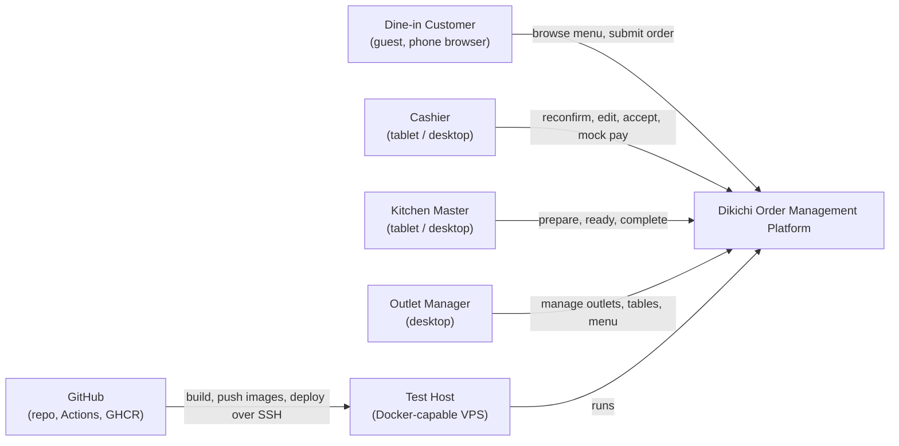

The platform is an independent academic prototype. It has **no** connection to Dikichi production systems, payment gateways, or notification services. Payment is mocked, and the order-ready announcement happens offline.

## 4. Container View

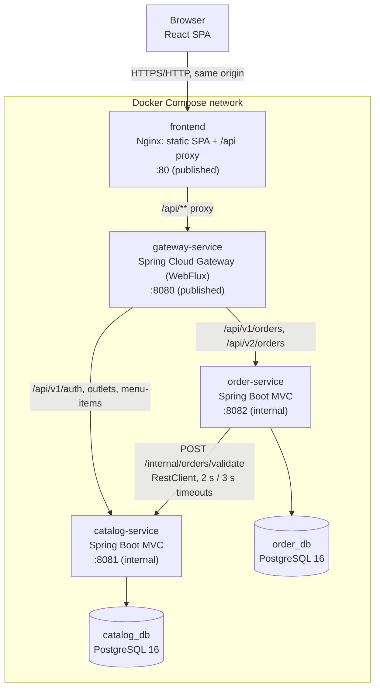

| Container | Technology | Responsibility | Data |
| :--- | :--- | :--- | :--- |
| `frontend` | React 18+, Vite, TS strict, Tailwind, React Router, TanStack Query, Zod. Served by Nginx | Four dashboards plus login. Proxies `/api` to the gateway, so there is one origin and no CORS | `sessionStorage` (JWT) |
| `gateway-service` | Spring Cloud Gateway (2025.1.x), WebFlux | Single entry point, routing, JWT validation, identity header injection and stripping | none |
| `catalog-service` | Spring Boot 4.0.x, Spring MVC, Data JPA, Flyway | Outlets, tables, menu items, staff login, JWT issuing, internal validation | `catalog_db` |
| `order-service` | Spring Boot 4.0.x, Spring MVC, Data JPA, Flyway, RestClient | Orders, v1/v2 contracts, state machine, mock payment | `order_db` |

## 5. Service Decomposition

### 5.1 Why these boundaries

| Boundary | Reasoning |
| :--- | :--- |
| **Catalog** groups outlet, table, menu item, and staff user | These change together (master data), are read-heavy, and are needed by both guests and staff. Putting login here avoids a fourth service (D8) |
| **Order** groups order, order item, and payment | One aggregate with one lifecycle and the strongest consistency need (atomic pay, optimistic locking). Payment is part of the order transaction, so it is not a separate service |
| **Gateway** has no business logic | Cross-cutting concerns only: routing, authentication, header hygiene |

**Rejected alternatives:**
- *Separate payment service.* Pay must atomically insert a payment and change the order status. Splitting them would need a saga for a mock payment, which is not justified here.
- *Separate auth service.* Adds a service and a database for three seeded accounts (D8).
- *Shared database.* Violates C2 and couples the services' schemas.

### 5.2 Data ownership

| Data | Owner | Other services access it via |
| :--- | :--- | :--- |
| Outlet, Table, MenuItem, StaffUser | catalog-service | Public REST (`GET`) or `/internal/orders/validate` |
| Order, OrderItem, MockPayment | order-service | Public REST only |

`order_db` keeps `outlet_id`, `table_code`, and `menu_item_id` as plain values with no cross-database foreign keys. Item name and price are **snapshotted** into `order_item`, so order-service never needs to call catalog to *read* an order. It calls catalog only on create and `PUT`.

## 6. Component View (internal structure, all services)

Layering is fixed by PRD §13: `controller` → `service` → `repository`, with `dto`, `mapper`, `config`.

```text
com.ambatucode.dikichi.order              # PRD D21
├── config/          RestClient bean (timeouts), Jackson, OpenAPI, identity filter registration
├── controller/
│   ├── v1/          OrderV1Controller           (/api/v1/orders)
│   └── v2/          OrderV2Controller           (/api/v2/orders)
├── dto/
│   ├── v1/          V1OrderRequest, V1OrderResponse
│   ├── v2/          V2OrderRequest, V2OrderResponse, V2Customer, V2Location, V2PaymentSummary
│   └── common/      OrderStatusPatchRequest, PaymentRequest, OrderItemRequest/Response, ErrorResponse
├── mapper/          OrderV1Mapper, OrderV2Mapper
├── service/         OrderService, OrderStateMachine, PaymentService, CatalogClient
├── repository/      OrderRepository, MockPaymentRepository
├── entity/          Order, OrderItem, MockPayment, OrderStatus, PaymentMethod
└── exception/       ApiException + subclasses, GlobalExceptionHandler
```

```text
com.ambatucode.dikichi.catalog
├── config/       Security (BCrypt encoder), JWT encoder, OpenAPI
├── controller/   AuthController, OutletController, TableController, MenuItemController,
│                 InternalValidationController (/internal/**)
├── dto/          (single version; catalog has only v1)
├── mapper/
├── service/      AuthService, JwtService, OutletService, TableService, MenuItemService,
│                 OrderValidationService
├── repository/
├── entity/
└── exception/
```

```text
com.ambatucode.dikichi.gateway
├── config/       Route definitions, JWT decoder, security chain (public vs protected routes)
└── filter/       IdentityHeaderFilter (strip client X-User-*/X-Outlet-Id, inject from JWT)
```

**Rules applied in every service** (PRD §2 rule 3): one error format via a `@RestControllerAdvice`, DTOs never exposed as entities, Bean Validation on request DTOs, and business rules in `service` (never in controllers).

### 6.1 Authorization inside downstream services

The gateway authenticates, but every service still enforces role and outlet scope itself (PRD §8.4).

Each downstream service has a small servlet filter that reads `X-User-Name`, `X-User-Role`, and `X-Outlet-Id` into a request-scoped `CallerIdentity`. Service methods check it explicitly, for example `requireRole(CASHIER)` and `requireSameOutlet(order.outletId)`. Downstream services do not include the full Spring Security filter chain. `catalog-service` only needs `spring-security-crypto` for BCrypt and a JWT library to issue tokens. See OQ-ARCH-06.

## 7. Runtime View

### 7.1 Staff login and an authenticated call

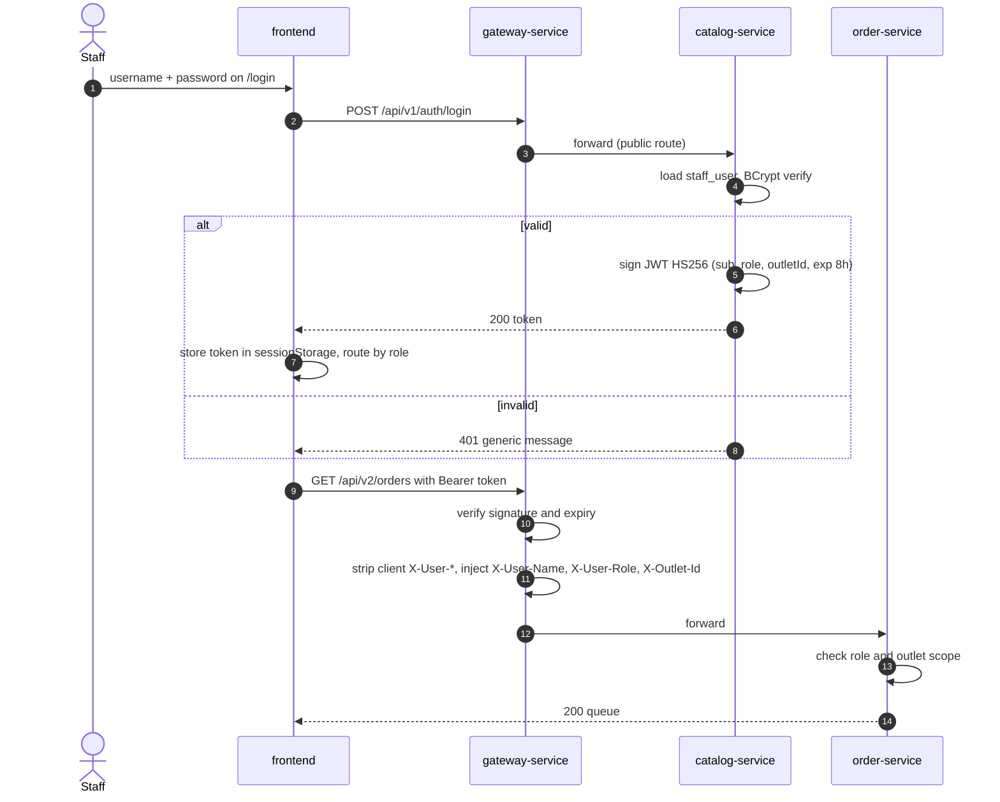

### 7.2 Guest places an order

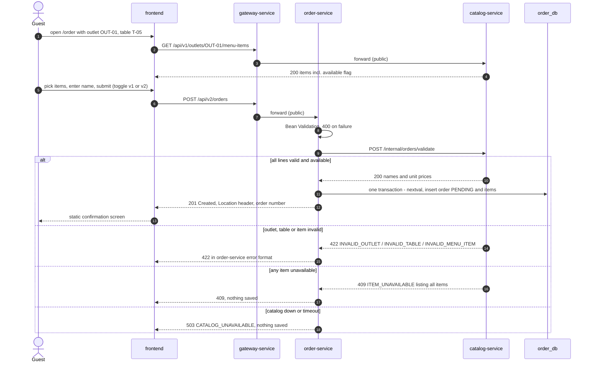

### 7.3 Cashier reconfirms, edits, accepts, and pays

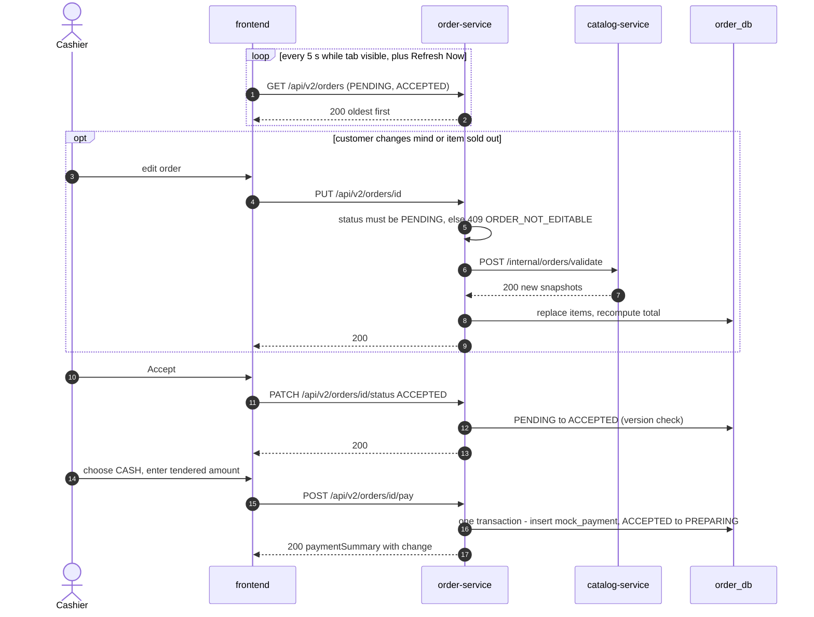

Accept and pay do **not** call catalog again (D12). The cashier fixes availability problems with `PUT` before accepting.

All calls in this diagram go through the gateway. It is omitted for readability.

### 7.4 Kitchen preparation

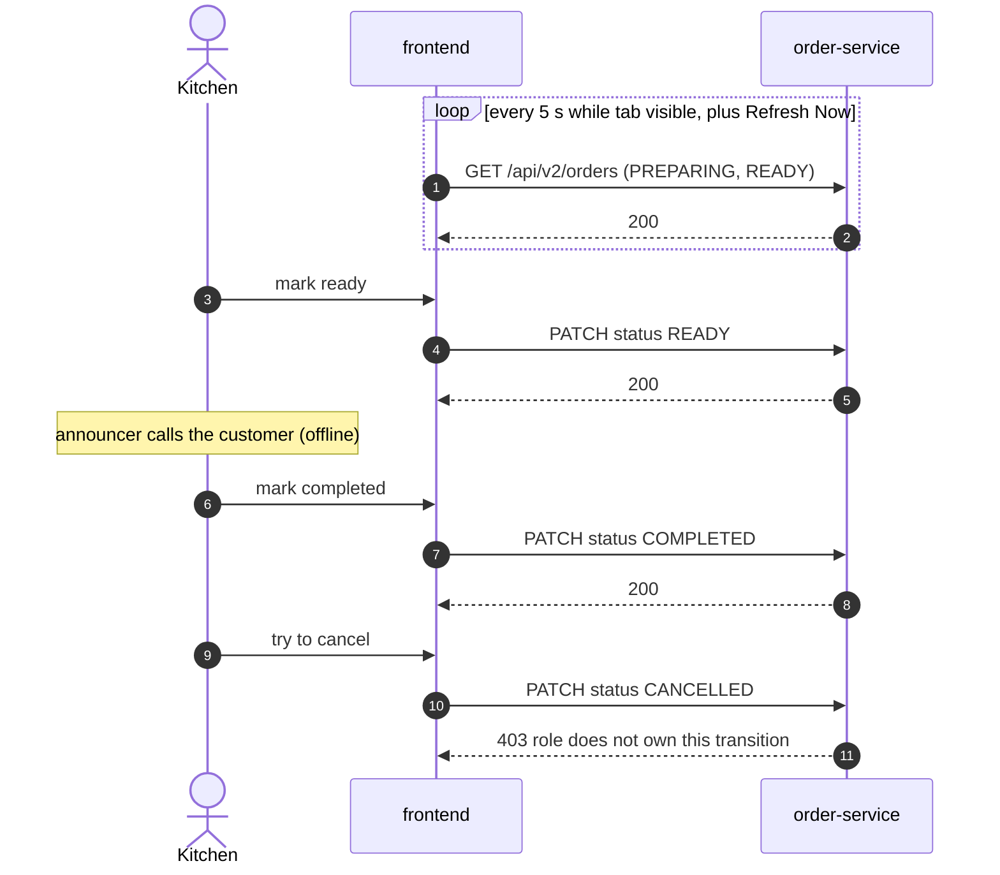

### 7.5 Concurrent modification

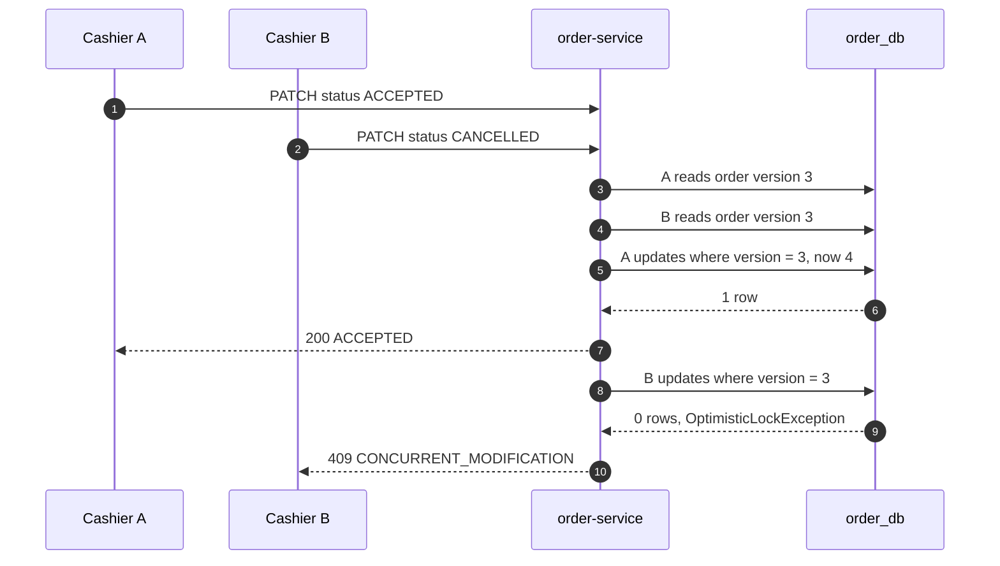

If B's request arrives *after* A has committed, B reads version 4 with status `ACCEPTED`. `ACCEPTED → CANCELLED` is still a legal transition, so B succeeds. Optimistic locking only protects truly simultaneous writes, and there is no `If-Match`/ETag to detect stale UIs (API spec OQ-API-13).

## 8. Order State Machine

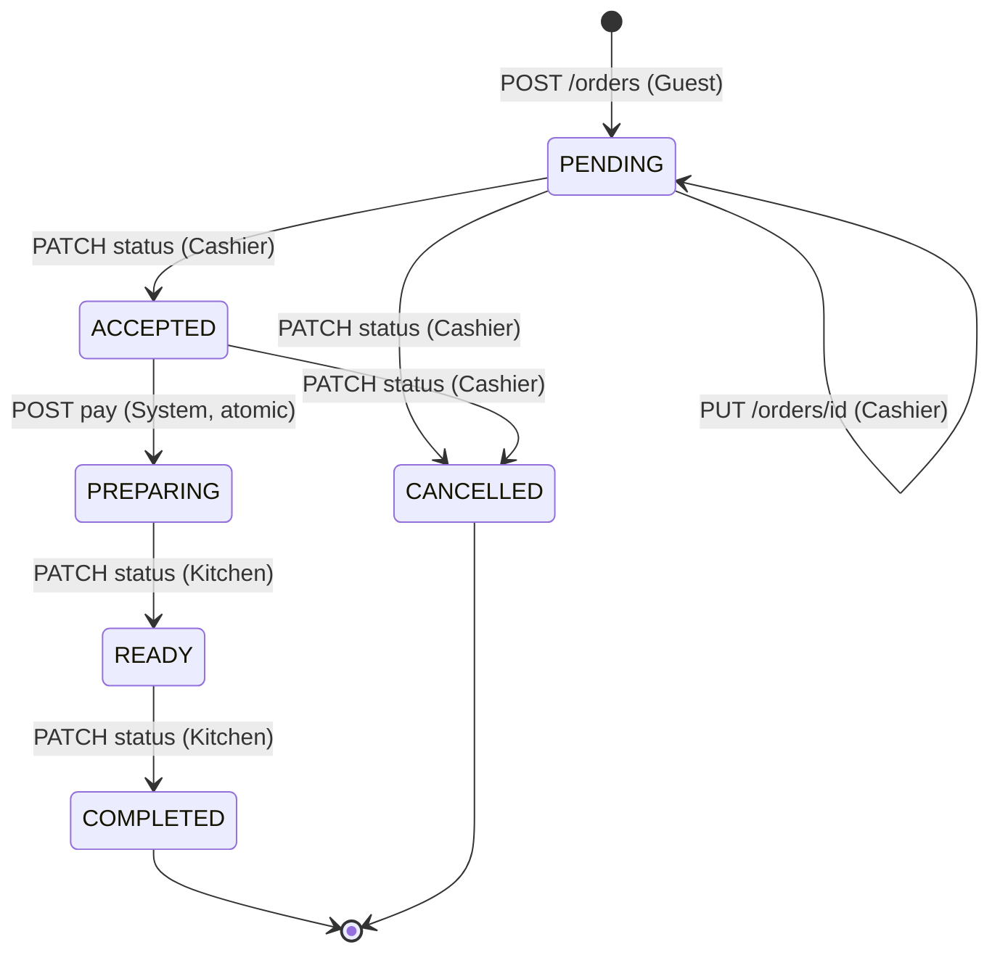

The state machine lives in one class (`OrderStateMachine`) shared by v1 and v2. Any other transition returns `409 INVALID_STATUS_TRANSITION`. `PREPARING` is reachable only through `pay`.

## 9. API Versioning Architecture

- Versioning style: **URI path** (`/api/v1`, `/api/v2`). It is visible in the browser network tab during the demo and needs no custom headers.
- Scope: **Order resource only** (D4). The gateway routes both prefixes to the same `order-service` instance.
- Within the service: two controllers → two mappers → **one** domain service. See [`API-Migration-v1-to-v2.md` §7](./API-Migration-v1-to-v2.md).
- Data is shared, so an order created through either version is visible through both.

## 10. Cross-Cutting Concerns

### 10.1 Security and trust boundaries

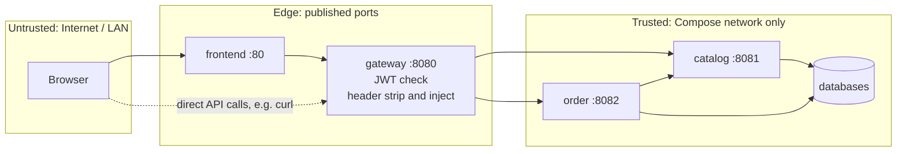

| Control | Implementation |
| :--- | :--- |
| Authentication | JWT HS256, 8 h, validated at the gateway. Secret from `JWT_SECRET` (≥ 32 bytes) |
| Header spoofing | Gateway removes client `X-User-Name`, `X-User-Role`, `X-Outlet-Id` before injecting its own |
| Network isolation | Only `frontend` and `gateway-service` publish host ports. Services and databases are internal |
| Internal API | `/internal/**` is never routed by the gateway |
| Defense in depth | Each service re-checks role and outlet scope (§6.1) |
| Passwords | BCrypt. Never logged or returned |
| Secrets | Environment variables and GitHub secrets only. `.env.example` lists names, never values |
| Error leakage | Global handler returns the standard error format with no stack traces |

**JWT libraries (PRD D23):** the gateway uses Spring Security's reactive resource server with `NimbusReactiveJwtDecoder.withSecretKey(...)` (HS256). catalog-service issues tokens with `NimbusJwtEncoder` and an `ImmutableSecret`. Using the same JOSE library on both sides avoids encoding mismatches.

### 10.2 Resilience

| Concern | Decision |
| :--- | :--- |
| order → catalog call | `RestClient`, connect timeout 2 s, read timeout 3 s, **no retry** |
| Catalog failure | `503 CATALOG_UNAVAILABLE`. The transaction is never opened or is rolled back, so nothing is saved |
| Catalog `4xx` | Mapped to the same status and code in order-service's own error format |
| Circuit breaker | Not used (PRD lists none). Timeouts give a fast enough failure at prototype scale |

### 10.3 Consistency

- **Within a service:** ACID transactions. Pay is a single transaction (insert payment and update status). Optimistic locking uses `orders.version`.
- **Across services:** there are no distributed transactions. The catalog is consulted synchronously at write time and its answer is snapshotted. If the catalog changes later (price edit, delete), existing orders keep their snapshots. This is intended, not an inconsistency.

### 10.4 Observability

- Structured JSON logs in every service with timestamp, service, level, and request path (PRD §13). Sensitive data such as passwords, tokens, and hashes is never logged.
- `/actuator/health` on every service. The CD job and Compose health checks use it.
- The gateway generates an `X-Request-Id` and forwards it; services include it in their logs to correlate a single request across services (PRD D22).

### 10.5 Frontend architecture

| Concern | Decision |
| :--- | :--- |
| Routing | React Router. `/order` and `/login` are public. `/cashier`, `/kitchen`, `/master` are guarded by role |
| Server state | TanStack Query. Queues use `refetchInterval: 5000`, paused when the tab is hidden, plus a "Refresh Now" button |
| Validation | Zod schemas mirror the server rules for UX only. The server is authoritative |
| API version | The customer page toggles v1/v2 for submission. Staff dashboards always use v2 |
| Constants | Status labels, categories, and static text live in one constants module |

## 11. Deployment View

### 11.1 Runtime topology (Docker Compose)

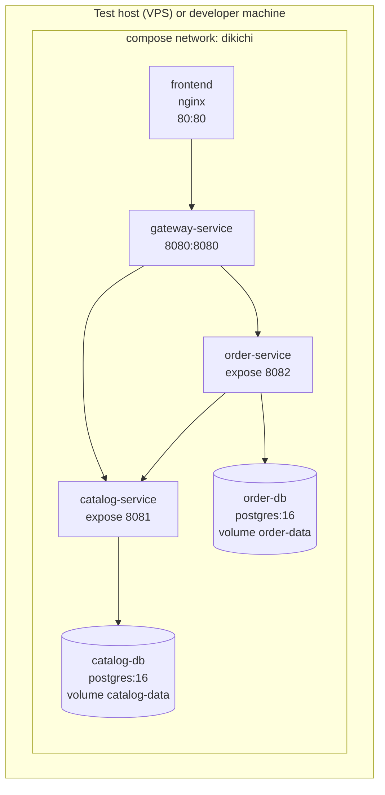

**Deployment decisions (PRD D22):**
- **Two PostgreSQL containers** (`catalog-db`, `order-db`) rather than one server with two databases. This makes the database-per-service isolation visible and independently restartable (PRD D22).
- Published host ports: `frontend` **80** and `gateway-service` **8080** (PRD D22).
- `depends_on` with `condition: service_healthy`: services wait for their database, and the gateway waits for the services (PRD D22).

### 11.2 CI/CD pipeline (GitHub Actions)

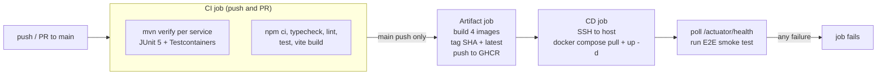

Secrets: `DEPLOY_HOST`, `DEPLOY_USER`, `DEPLOY_SSH_KEY`, `JWT_SECRET`, DB passwords. Deployment happens only through this pipeline (PRD §15). GitHub Actions only, with no Jenkins (D2).

## 12. Decision Traceability

| PRD decision | Architectural effect |
| :--- | :--- |
| D1 Single seeded outlet, multi-outlet model | `outletId` on every catalog row and order, plus outlet scope checks |
| D2 GitHub Actions only | §11.2 |
| D3 VPS over SSH | CD job uses SSH + Compose |
| D4 v2 on Orders only | §9. The gateway routes `/api/v2/orders/**` only |
| D7 String outlet key | Readable QR URLs, `VARCHAR` PK |
| D8 Login in catalog | No auth service. catalog issues JWT and gateway validates |
| D9 Testcontainers, no H2 | CI needs Docker (GitHub-hosted runners provide it) |
| D11 Boot 4.0.x + Cloud 2025.1.x | Boot 4 idioms. Fallback to Boot 3.5.x + Cloud 2025.0.x recorded if needed |
| D12 No availability re-check on accept/pay | §7.3: no catalog call after create/`PUT` |
| D13 No pagination | Queue endpoints return arrays. Index `(outlet_id, status)` keeps them fast |
| D14 Master has no order access | Order service rejects `MASTER` with `403` |

## 13. Risks (architecture-specific additions to PRD §18)

| Risk | Mitigation |
| :--- | :--- |
| Gateway public-route matcher too broad (for example making `/orders/{id}/pay` public) | Exact-path matchers. A gateway test asserts `401` on `POST /api/v1/orders/{id}/pay` without a token |
| Downstream service accidentally published to the host, which makes identity headers forgeable | Compose uses `expose`, not `ports`, for internal services. Covered in review and by a smoke check |
| Spring Boot 4 / Jackson 3 differences from Boot 3 tutorials | Pin versions. Keep `mvn verify` green after each service. Build the first service as the reference pattern |
| N+1 queries on queue endpoints | Fetch joins or entity graphs for order items (DB design §7) |

## 14. Resolved Architecture Decisions

The former OQ-ARCH-01 through OQ-ARCH-09 are closed by PRD §19, decisions D20–D23.

| Area | Final rule | PRD decision |
| :--- | :--- | :--- |
| Repository layout | Existing `Backend/`, `Frontend/`, `Documents/`; backend services and Compose under `Backend/` | D20 |
| Java packages and layering | `com.ambatucode.dikichi.<service>` with controller/service/repository/dto/mapper/config/entity/exception | D21 |
| Authorization | Gateway validates JWT and strips/injects identity headers; each downstream service independently checks role and outlet scope | D21 |
| Databases and published ports | Separate PostgreSQL containers; publish only frontend `80` and gateway `8080` | D22 |
| Correlation | Gateway creates `X-Request-Id`; all services log it | D22 |
| JWT library | Spring Security JOSE/Nimbus on issuing and validating sides | D23 |
| Compose health dependencies | Use `pg_isready` and Actuator health checks with `depends_on: condition: service_healthy` | D22 |
